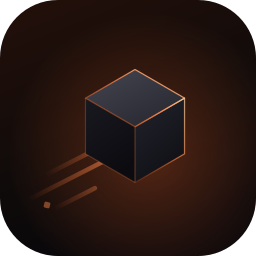
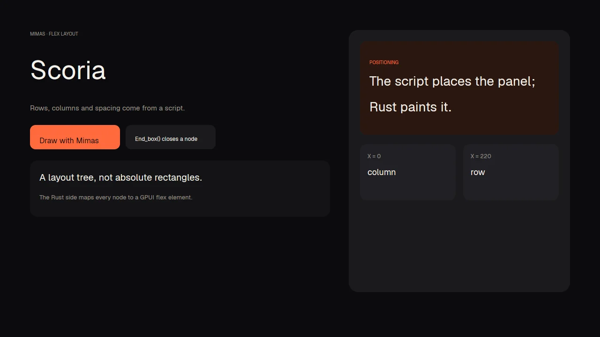
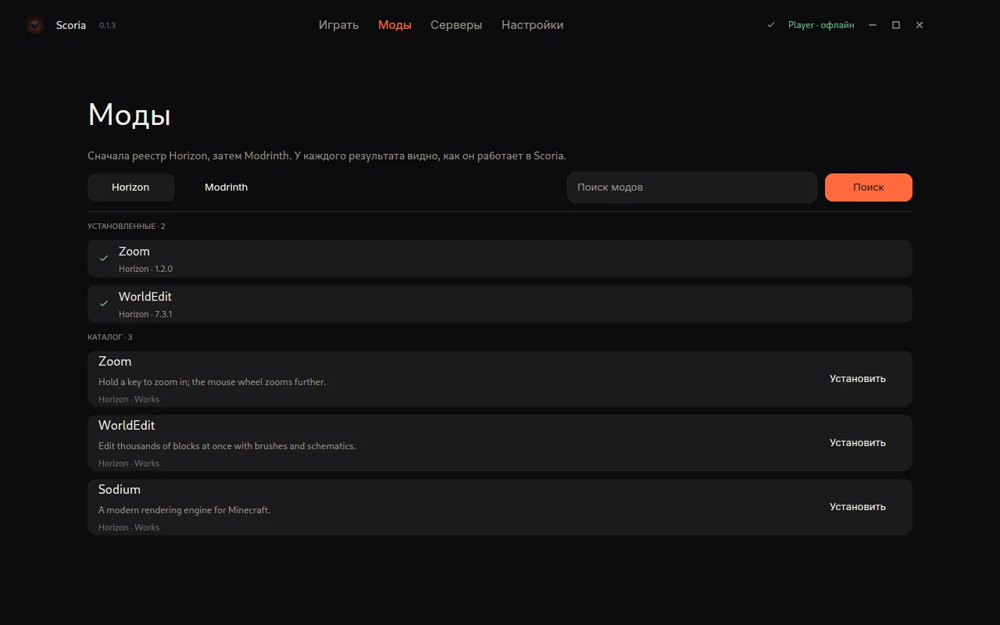
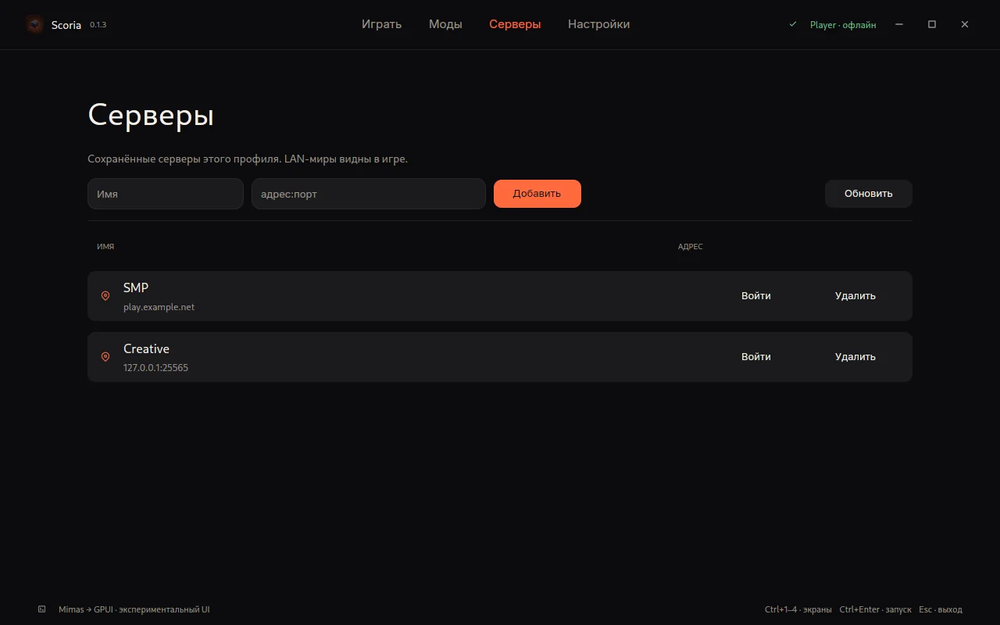
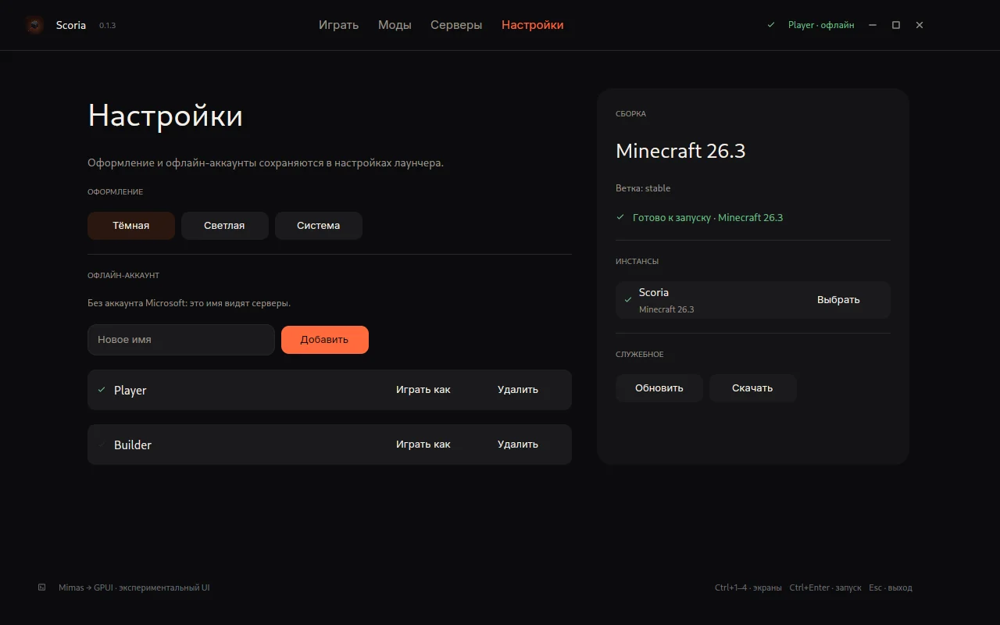
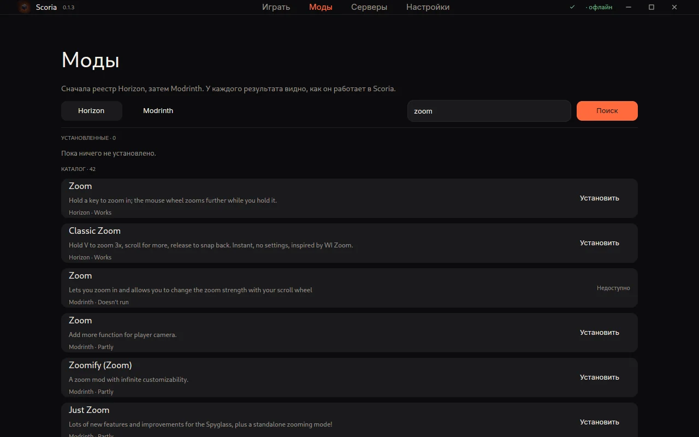
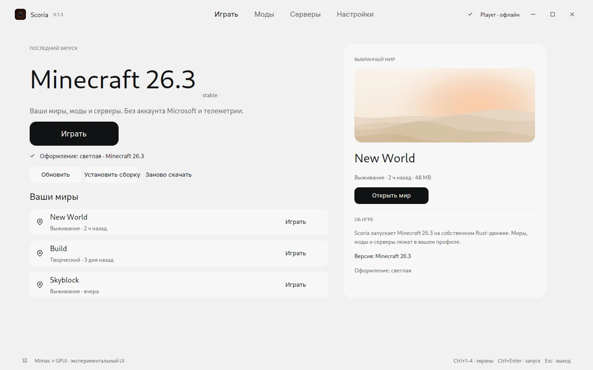
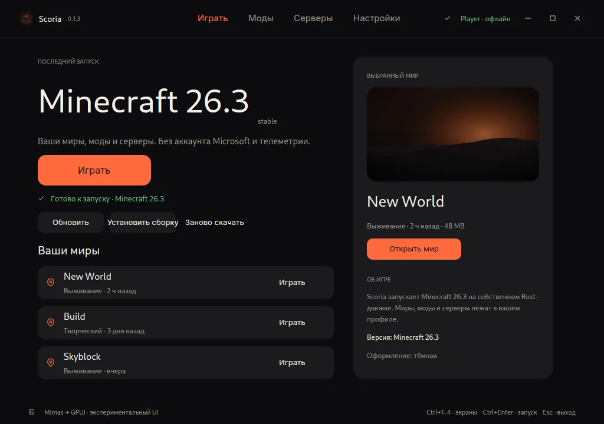

<p align="center">
  
</p>

<h1 align="center">Scoria · exp/mimas</h1>

<p align="center">
  <b>The whole launcher shell, scripted in Mimas.</b><br>
  Topbar, Home, Mods, Servers and Settings are one <code>.mim</code> file; Rust supplies data,
  performs actions and paints GPUI nodes.
</p>

<p align="center">
  
  
  
  
</p>



| Mods | Servers |
| --- | --- |
|  |  |

| Settings | Real catalogue search |
| --- | --- |
|  |  |

| Light theme | Home at 1024×720 |
| --- | --- |
|  |  |

All four screens are Mimas trees. Navigation, Play/Stop, download progress, catalogue search,
installs, saved servers and offline accounts call the same `scoria-core` functions as the
production launcher.

📖 **[The scripting syntax and host API →](docs/mimas-ui.md)**

---

## What this branch is

`exp/mimas` is a research branch, not a release. It asks:

> Can the launcher's interface be described by a small typed script while GPUI still renders it
> and Rust keeps every privileged action?

The answer so far: **yes for a full four-screen shell with real data and actions; not yet a
drop-in replacement for the production UI.**

```mimas
fn home() {
    scroll(0.0, 0.0, 0.0, 0.0, theme_color("transparent"), 0.0);
        fill_w();
        row(32.0, 0.0, 0.0, 0.0, theme_color("transparent"), 0.0);
            fill_w();
            align("stretch");
            column(12.0, 0.0, 0.0, 0.0, theme_color("transparent"), 0.0);
                w_pct(0.56);
                text("ПОСЛЕДНИЙ ЗАПУСК", 10.0, theme_color("muted"));
                text(version(), 56.0, theme_color("text"));
                text_fill("Ваши миры, моды и серверы.", 15.0, theme_color("muted"));
                action_button();
                text("Ваши миры", 20.0, theme_color("text"));
                let i = 0.0;
                while i < world_count() {
                    row(14.0, 14.0, 0.0, 56.0, theme_color("surface2"), 12.0);
                        fill_w();
                        align("center");
                        icon("map-pin", 16.0, theme_color("accent"));
                        text(world_name(i), 16.0, theme_color("text"));
                        spacer();
                        small_button("Играть", f"play-world:{world_folder(i)}", theme_color("transparent"));
                    end_box();
                    i = i + 1.0;
                }
            end_box();
        end_box();
    end_box();
}
```

```text
launcher/ui/dev/mimas-ui/scene.mim   the whole UI, hot-reloaded
launcher/ui/examples/mimas_ui.rs     host functions, state, actions and GPUI rendering
docs/mimas-ui.md                        syntax, state functions, actions, limits
```

## Run it

```sh
cd launcher
cargo run -p scoria-ui --features dev-scripts --example mimas-ui
```

Use another scene:

```sh
SCORIA_MIMAS_UI=/path/to/scene.mim \
  cargo run -p scoria-ui --features dev-scripts --example mimas-ui
```

The example calls the real launcher engine. Point it at a scratch profile when experimenting:

```sh
HORIZON_HOME=$(mktemp -d) HORIZON_LAUNCHER_HOME=$(mktemp -d) \
  cargo run -p scoria-ui --features dev-scripts --example mimas-ui
```

## What is real

- **State** — build, branch, prepared/playing, offline name, appearance, worlds, instances.
- **Download and prepare** — the same `prepare_game_with_progress` path as the window, with a
  live percentage, log line and cancel.
- **Play and Stop** — `start_game`, `start_server`, `stop_game`, `play-world:<folder>`.
- **Catalogue** — Horizon first, then Modrinth, with the support verdict; installs go through
  `install_project`. Results that do not run on Scoria show “Недоступно”.
- **Servers** — the player's `servers.dat`: add, remove, join.
- **Offline accounts** — add, select and remove names in `accounts.json`.
- **Settings** — appearance and instance selection are saved where the production UI reads them.
- **Inputs** — real `EditableTextState` fields: caret, selection, clipboard, undo and IME, plus
  `Tab`/`Shift+Tab` and `Enter`.
- **Theme** — colours come from `theme_color(...)`; Dark/Light applies immediately and the light
  backdrop is used.
- **Responsive** — the root fills the window; columns use `w_pct`, `fill_w` and `grow`, pages
  scroll, and the layout works from 1024×720 to wide windows.
- **Window** — the brand area drags the window; minimize, maximize and close are real buttons.
- **Errors** — a toast with a close button, not a corner overlay.
- **Hot reload** — saving `scene.mim` rebuilds the window in ~300 ms.

## What is still experimental

- Every action rebuilds the whole tree; there is no incremental diff.
- No accessibility tree or screen-reader labels yet (editable fields do expose roles).
- `System` follows the production behaviour and currently resolves to the dark palette.
- No native system menu; only the three window buttons and dragging.
- Flex only: no grid, constraints or measured text.
- A few launcher features are still missing: remove-mod, language switch, while-playing,
  create/backup world, LAN list, modpack import.
- The VM, hot reload and demo helpers are behind the developer-only `dev-scripts` feature. A
  player build does not include them.

## Measurements

Measured on the development machine (release, X11/XWayland, 3 runs, median). The “same app”
rows use the production launcher binary; the last row is the standalone example.

| Build | Binary | RSS after 3 s | Window appears |
|---|---:|---:|---:|
| launcher, no Mimas feature | 50 MB | 140.2 MB | 232–254 ms |
| same launcher, `dev-scripts`, no script | 53 MB | 140.9 MB | 231–244 ms |
| same launcher + one `draw()` scene | 53 MB | 145.1 MB | 231–244 ms |
| Mimas launcher example (this branch) | 50 MB | 134.0 MB | 229–247 ms |

In the same app the VM plus one compiled scene costs **~4.2 MB RSS (~3%)**, **~3 MB of binary**
and no measurable startup change. The example links the real `scoria-core` for data and actions,
so it no longer fits in the old 35 MB shell; it is still lighter than the production launcher
because it skips engine code and some assets — it is not a “UI replaced by Mimas” cost comparison.

Reproduce the in-app cost:

```sh
cd launcher
cargo build --release --features dev-scripts -p scoria-ui
HORIZON_LAUNCHER_HOME=$(mktemp -d) target/release/scoria
```

Release assets:

- `scoria-launcher-linux-x86_64.tar.zst` and `scoria-launcher-windows-x64.zip` — the launcher itself.
- `scoria-game-*` — the engine and asset bundle. The launcher downloads and installs it itself on
  the first launch; do not download it by hand.

## The rest of Scoria

The production launcher (Rust/GPUI + `scoria-ui-kit`), docs, build instructions and release
links live on `dev` and `main`:

- [`README.md`](https://github.com/wshrx/scoria/blob/dev/README.md)
- [`docs/`](https://github.com/wshrx/scoria/tree/dev/docs)
- [Latest release](https://github.com/wshrx/scoria/releases)

> Not an official Minecraft product. Not approved by or associated with Mojang or Microsoft.
> Scoria contains no Minecraft code, assets or data; you need your own copy of Minecraft: Java
> Edition 26.3.
