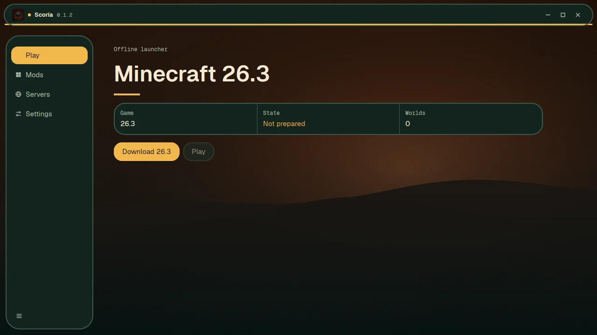
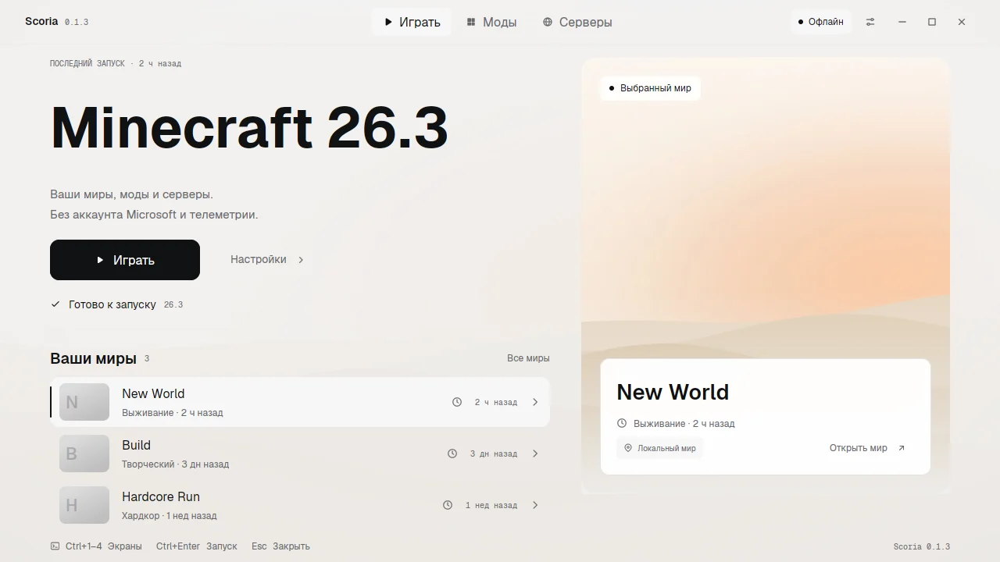
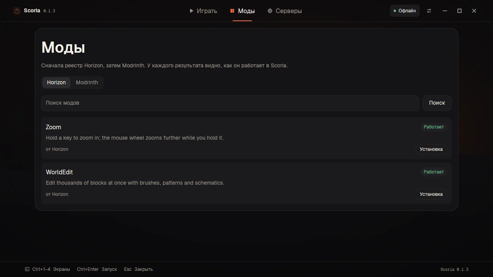
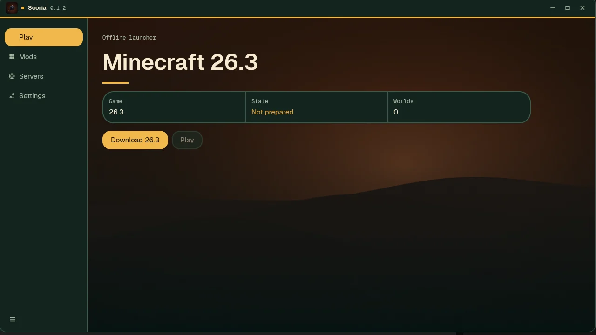

<p align="center">
  
</p>

<h1 align="center">Scoria</h1>

<p align="center">
  <b>Minecraft: Java Edition 26.3 — a native Rust client and launcher.</b><br>
  Offline by default. No Microsoft account. No telemetry. No game assets.
</p>

<p align="center">
  <a href="https://github.com/wshrx/scoria/releases/latest"></a>
  <a href="https://github.com/wshrx/scoria/actions/workflows/ci.yml"></a>
  
  
  
  
</p>

<p align="center">
  <a href="#download">Download</a> ·
  <a href="#the-launcher">Launcher</a> ·
  <a href="#what-works">What works</a> ·
  <a href="#build-from-source">Build</a> ·
  <a href="#status">Status</a> ·
  <a href="README.ru.md">Русский</a>
</p>



## The launcher

The 0.1.3 redesign is **D · Signal** in the dark and **E · White** in the light: one topbar, one
state-aware action, a selected-world poster and 64 px world rows. The window watches the instance
folder, so a world, mod or shader pack written by the game (or a dev build) appears without a
restart.

| Home, dark | Home, light |
| --- | --- |
|  |  |

| Mods | Settings |
| --- | --- |
|  |  |

## Download

The launcher installs the engine itself and asks for **your own** Minecraft 26.3 files. No Mojang
assets are shipped.

| Platform | Asset |
| --- | --- |
| Linux x86_64 (Wayland, Vulkan) | `scoria-launcher-linux-x86_64.tar.zst` |
| Windows 10/11 x64 (Vulkan) | `scoria-launcher-windows-x64.zip` |

Open the [latest release](https://github.com/wshrx/scoria/releases/latest), unpack it and run
`scoria`. The engine bundle lives in the separate `v0.1.2-beta-game` pre-release as
`scoria-game-linux-x86_64.tar.zst` / `scoria-game-windows-x64.zip`; the launcher downloads and
installs it itself.

## What works

- **Offline by default.** Create one or more offline accounts in Settings; there is no sign-in,
  session file, token or account service. Servers see the offline name.
- **Vanilla worlds.** Saves stay in vanilla's format; world generation, mobs, villages, redstone,
  commands and the HUD follow vanilla 26.3.
- **One game action.** Download 26.3 → Preparing → Play → Stop, with the engine's last line and a
  progress bar. Leaving the game clears Playing immediately.
- **Modrinth and Horizon.** Search, install and label each project **Works / Partly / Doesn't run**
  before it reaches the game. CurseForge is not supported.
- **Your own files.** Reads the official launcher, Prism, Freesm, MultiMC, the Modrinth App or
  ATLauncher; downloads the pinned 26.3 from Mojang's piston-meta if none has it.
- **A native window.** gpui-ce, a custom titlebar, rounded controls, dark/light themes, English,
  French and Russian; `app_id=scoria` and a matching desktop icon on Wayland.
- **Developer tooling.** `SCORIA_UI_STATE` renders 19 synthetic states; an optional Mimas harness
  drives download and screen flows without a game. Neither ships in a player build.

## Build from source

Requirements: Rust 1.95+ (edition 2024 dependencies), Linux `libasound2-dev libudev-dev`, or the
Windows build tools.

```sh
git clone https://github.com/wshrx/scoria.git
cd scoria/launcher
cargo xtask gate          # fmt, clippy, tests, UI build and pytest
cargo xtask ui            # run the launcher
```

See [BUILDING.md](BUILDING.md) and [docs/](docs/) for the engine, the launcher CLI and the
packaging flow.

## Status

Scoria is in **beta**. The latest tagged release is `v0.1.2-beta`; the 0.1.3 redesign is in the
`dev` and `main` branches and is the next release. Known gaps:

- Windows runtime and installer smoke tests are not finished.
- Online-mode servers are refused: Scoria has no Microsoft session by design.
- Java shader packs are not supported; Horizon's own WGSL `.hshader` packs are.
- CurseForge, launcher auto-update and a first-class engine-update UI are not implemented.

## Docs

- [Launcher](launcher/README.md): CLI, MCP, downloads, releases and the window.
- [Launcher UI states](docs/qa/launcher-ui-states.md): the 19-state screenshot matrix.
- [Developer scripts](docs/mimas-scripts.md): the opt-in Mimas harness.
- [Shader packs](docs/shaders.md), [mods](docs/mods.md), [hosting](docs/hosting.md).
- [Architecture](docs/architecture.md) and [project state](docs/).

## License

MIT — see [LICENSE](LICENSE) and [THIRD_PARTY_NOTICES.md](THIRD_PARTY_NOTICES.md).

Scoria is not an official Minecraft product, is not approved by or associated with Mojang or
Microsoft, and ships no Minecraft code, assets or data. You need your own copy of Minecraft: Java
Edition 26.3.
