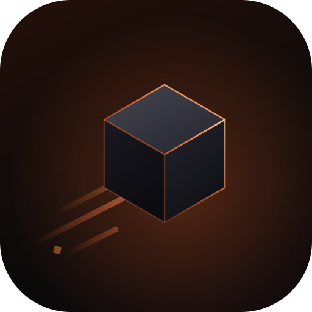

<p align="center">
  
</p>

<h1 align="center">Scoria</h1>

<p align="center">
  <b>A launcher and client for Minecraft: Java Edition 26.3, written in Rust.</b><br>
  Offline by default. No Microsoft account. No telemetry. No game assets.
</p>

<p align="center">
  <a href="#download">Download</a> ·
  <a href="#what-it-is">What it is</a> ·
  <a href="#assets-and-ownership">Assets</a> ·
  <a href="#what-works">What works</a> ·
  <a href="#build-from-source">Build</a> ·
  <a href="README.ru.md">Русский</a>
</p>

<p align="center">
  
  
  
  
</p>

## Builds

**The first beta is out:** [v0.1.0-beta](https://github.com/wshrx/scoria/releases/tag/v0.1.0-beta).
Linux and Windows archives are attached with a game client bundle, `SHA256SUMS` and its signature.
A launcher archive alone cannot play: it installs the matching game bundle on first run and prepares
26.3 locally from your own files or Mojang's servers. No Minecraft assets are shipped.

| Platform | Status |
|---|---|
| Linux x86_64 (Wayland, Vulkan) | `v0.1.0-beta` |
| Windows 10/11 x64 (Vulkan) | `v0.1.0-beta` |
| macOS 14+, Apple silicon | deferred until signing and notarization |

## What it is

Scoria is a native launcher and client. It reads vanilla worlds, follows vanilla rules and starts
without a session. Saves, options and mods stay on your machine.

**Scoria is an independent fork of [Horizon](https://github.com/horizon-rust/horizon) (MIT).** The
engine and parts of the launcher come from Horizon; Scoria adds the offline launcher, piston-meta
downloads, Modrinth support, the new UI and its branding. It is not an official Minecraft product
and is not approved by or associated with Mojang or Microsoft.

- **No account.** Offline profiles, LAN and offline-mode servers. Online-mode servers need a
  Microsoft session, which Scoria does not have.
- **Downloads from Mojang.** Scoria fetches the pinned 26.3 files from Mojang's piston servers
  into its own folder on first prepare. It does not scan or modify other launchers. Scoria ships
  no game data and never redistributes it.
- **Modrinth, labelled.** Mods and resource packs show **Works**, **Partly** or **Doesn't run**
  before you install. Java mods are ported to Scoria's runtime; Java itself is not run.
- **A real desktop app.** 1280×720, dark and light Ember themes, keyboard navigation, toasts and
  confirmations. Linux is Wayland-native; macOS and Windows use the native frame.

## Assets and ownership

This is the legal boundary, in plain words:

- Scoria contains **no Minecraft code, textures, sounds, language files, data or other assets**.
- Release archives contain only Scoria/Horizon binaries, the UI, the bundled fonts (SIL OFL) and
  the Scoria mark.
- Game files are **downloaded from Mojang's servers on request** or taken from an installation you
  already have. They are stored locally and never uploaded.
- You need your own copy of **Minecraft: Java Edition 26.3**.
- Screenshots in this README show the **launcher UI only**, not game content.
- Horizon's MIT notice and every third-party licence are in
  [THIRD_PARTY_NOTICES.md](THIRD_PARTY_NOTICES.md).

If you redistribute Scoria, keep the MIT notice and do not add game assets to the archive.

## What works

| | |
|---|---|
| ✅ Single player, vanilla world generation, mobs, villages, redstone, commands, HUD | ❌ Online-mode servers (no Microsoft session, by design) |
| ✅ LAN and offline-mode servers | ❌ CurseForge |
| ✅ Modrinth mods and resource packs, with support labels | ❌ Modpack browser in the launcher (the engine can import and port) |
| ✅ World backups, screenshots, options, resource packs | ❌ OptiFine/Java shader packs; Scoria's `.hshader` source is not published yet |
| ✅ Dark / light Ember themes, Russian and English | ❌ Windows on ARM, Intel Macs |
| ✅ Linux (Wayland), macOS (Apple silicon), Windows (x64) | ❌ Code signing / notarization (beta) |

## Screenshots

UI captures will be added with the first beta. This page will not show game content: Scoria ships
no Minecraft assets.

## Install

Linux: unpack the tarball and run `scoria-launcher-ui`. Windows: unzip and run `Scoria.cmd`
(SmartScreen warns until signed). macOS is deferred: there is no archive yet. The first launch asks for nothing; press **Download and prepare**
once and Scoria prepares 26.3 locally from your own files or Mojang's servers.

## Release channels

There is no `nightly` branch. A branch is not a distribution channel: releases are **tags** on
`dev`, built by CI and attached to GitHub Releases. Tags are plain pointers to commits; the notes
live in [CHANGELOG.md](CHANGELOG.md) and are copied into the release body.

| Tag | Meaning |
|---|---|
| `v0.1.N-beta` | public beta; `N` grows by one for every published build (`0.1.0-beta`, `0.1.1-beta`, ...) |
| `v0.2.0` | first stable release, once the betas are clean |
| `v0.2.1`, ... | fixes after that |

Work that is not published is not tagged: it lives in the history of `dev`. A CI run without a tag
is a build, not a release.

## Build from source

Rust 1.90+, Bun 1.4+, and a Vulkan-capable GPU.

```sh
cd launcher && cargo build --release
cd ../launcher-ui && bun install && bun run build
sh tools/package_ui.sh        # Linux bundle
sh tools/package_macos.sh     # macOS .app
sh tools/package_windows.sh   # Windows zip
```

Run the UI in development with `bun run dev` (Linux: native Wayland, no XWayland).

## How it is put together

```
crates/        Rust engine: client, world, protocol, assets, preparation, servers
launcher/      Rust launcher engine + JSON-lines API (horizon-launcher api)
launcher-ui/   React on GPUIX + flint-ui (screens, layout, mods, feedback)
docs/          engine and user documentation
```

The UI never touches the disk or starts the game; it talks to the launcher over JSON lines. The
launcher prepares Mojang files, ports Java mods to the Rust runtime, and starts the client.

## Status

Beta. The engine is Horizon's; Scoria adds the offline launcher, piston-meta downloads, Modrinth
support, the new UI and its branding. Roadmap and known gaps are in
[Issues](https://github.com/wshrx/scoria/issues).

## Credits

- Engine: [Horizon](https://github.com/horizon-rust/horizon), MIT.
- Typefaces: **Medeo Sans** and **Medeo Mono** by the Medeo Project Authors (DNFDEVS), SIL OFL.
  The Scoria wordmark is outlined from Medeo Sans Bold.
- UI: GPUIX and flint-ui.

## License

MIT — see [LICENSE](LICENSE) and [THIRD_PARTY_NOTICES.md](THIRD_PARTY_NOTICES.md).

Scoria is not an official Minecraft product, is not approved by or associated with Mojang or
Microsoft, and ships no Minecraft code, assets or data. You need your own copy of Minecraft: Java
Edition 26.3.
