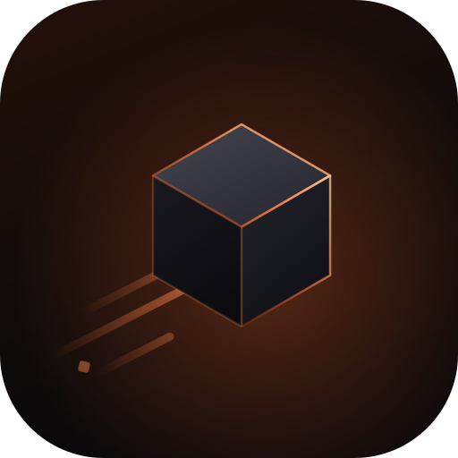

<p align="center">
  
</p>

<h1 align="center">Scoria</h1>

<p align="center">
  <b>Лаунчер и клиент для Minecraft: Java Edition 26.3 на Rust.</b><br>
  Офлайн по умолчанию. Без аккаунта Microsoft. Без телеметрии. Без игровых ассетов.
</p>

<p align="center">
  <a href="#скачать">Скачать</a> ·
  <a href="#что-это">Что это</a> ·
  <a href="#ассеты-и-права">Ассеты</a> ·
  <a href="#что-работает">Что работает</a> ·
  <a href="#сборка-из-исходников">Сборка</a> ·
  <a href="README.md">English</a>
</p>

## Скачать

**Скачивайте только лаунчер.** Игроку нужен файл `scoria-launcher-*`. `scoria-game-*` — это
бандл движка: лаунчер сам скачает и установит его, вручную его качать **не нужно**.

| Платформа | Что скачать | Как запустить |
|---|---|---|
| Linux x86_64 | `scoria-launcher-linux-x86_64.tar.zst` | распаковать, затем `./scoria` |
| Windows 10/11 x64 | `scoria-launcher-windows-x64.zip` | распаковать, затем `scoria.exe` |

1. Скачайте лаунчер для своей системы и запустите его.
2. Один раз нажмите **Скачать 26.3**. Scoria установит подходящий бандл движка и скачает файлы
   26.3 с серверов Mojang в свою папку: около 600 МБ при первом запуске, с процентом на экране.
3. Нажмите **Играть**.

На странице релиза также лежат `scoria-game-*` (для прозрачности), `SHA256SUMS` и подпись. Это не
файлы для игрока: ими занимается лаунчер. SmartScreen предупредит о `scoria.exe`, пока сборка не
подписана.

**Первая beta вышла:** [v0.1.0-beta](https://github.com/wshrx/scoria/releases/tag/v0.1.0-beta).

| Платформа | Статус |
|---|---|
| Linux x86_64 (Wayland, Vulkan) | `v0.1.0-beta` |
| Windows 10/11 x64 (Vulkan) | `v0.1.0-beta` |
| macOS 14+, Apple silicon | отложена до подписи и нотаризации |

## Что это

Scoria — нативный лаунчер и клиент. Читает ванильные миры, следует ванильным правилам и
запускается без сессии. Миры, настройки и моды остаются на вашей машине.

**Scoria — независимый форк [Horizon](https://github.com/horizon-rust/horizon) (MIT).** Движок и
часть лаунчера взяты из Horizon; Scoria добавляет офлайн-лаунчер, загрузку с piston-meta,
поддержку Modrinth, новый интерфейс и брендинг. Это не официальный продукт Minecraft, он не
одобрен Mojang или Microsoft и не связан с ними.

- **Без аккаунта.** Офлайн-профили, LAN и offline-mode серверы. Для online-mode нужна сессия
  Microsoft, которой у Scoria нет.
- **Скачивает с Mojang.** При первой подготовке Scoria берёт закреплённые файлы 26.3 с
  piston-серверов Mojang в свою папку. Другие лаунчеры не сканируются и не меняются. Scoria не
  поставляет и не распространяет игровые данные.
- **Modrinth с метками.** Моды и ресурспаки показывают **Работает**, **Частично** или
  **Не запустится** до установки. Java-моды портируются; Java не запускается.
- **Нормальное приложение.** 1280×720, тёмная и светлая темы Ember, клавиатурная навигация, тосты и
  подтверждения. Linux — нативный Wayland; macOS и Windows — системная рамка.

## Ассеты и права

Граница простыми словами:

- В Scoria **нет кода, текстур, звуков, языковых файлов, данных и других ассетов Minecraft**.
- В релизных архивах только бинарники Scoria/Horizon, интерфейс, шрифты (SIL OFL) и знак Scoria.
- Файлы игры **скачиваются с серверов Mojang по запросу** или берутся из вашей установки.
  Хранятся локально и никуда не отправляются.
- Нужна собственная копия **Minecraft: Java Edition 26.3**.
- Скриншоты в README показывают **только интерфейс лаунчера**, не игровой контент.
- MIT-уведомление Horizon и все сторонние лицензии — в
  [THIRD_PARTY_NOTICES.md](THIRD_PARTY_NOTICES.md).

Если вы распространяете Scoria, сохраните MIT-уведомление и не добавляйте игровые ассеты в архив.

## Что работает

| | |
|---|---|
| ✅ Одиночная игра, генерация, мобы, деревни, редстоун, команды, HUD | ❌ Online-mode серверы (нет сессии Microsoft) |
| ✅ LAN и offline-mode серверы | ❌ CurseForge |
| ✅ Моды и ресурспаки Modrinth с метками совместимости | ❌ Браузер модпаков в лаунчере |
| ✅ Бэкапы миров, скриншоты, настройки, ресурспаки | ❌ Шейдеры OptiFine/Java |
| ✅ Тёмная / светлая темы Ember, русский и английский | ❌ Windows ARM, Intel Mac |
| ✅ Linux (Wayland), macOS (Apple silicon), Windows (x64) | ❌ Подпись и нотаризация (beta) |

## Скриншоты

Снимки интерфейса появятся с первой beta. Игрового контента здесь не будет: Scoria не поставляет
ассеты Minecraft.

## Установка

Linux: распаковать `scoria-launcher-linux-x86_64.tar.zst` и запустить `./scoria`. Windows:
распаковать `scoria-launcher-windows-x64.zip` и запустить `scoria.exe` (SmartScreen предупредит,
пока не подписана). macOS отложена: архива пока нет. Первый запуск ничего не спрашивает; нажмите
**Скачать 26.3** один раз — Scoria установит бандл движка и подготовит 26.3 из ваших файлов или с
серверов Mojang.

## Каналы релизов

Ветки `nightly` нет. Ветка — не канал распространения: релизы — это **теги** на `dev`, CI
собирает их и прикладывает к GitHub Releases. Теги — просто указатели на коммиты; заметки лежат
в [CHANGELOG.md](CHANGELOG.md) и попадают в тело релиза.

| Тег | Значение |
|---|---|
| `v0.1.N-beta` | публичная бета; `N` растёт на единицу с каждой публикацией (`0.1.0-beta`, `0.1.1-beta`, ...) |
| `v0.2.0` | первый стабильный релиз, когда беты станут чистыми |
| `v0.2.1`, ... | исправления после него |

Неопубликованная работа не тегируется: она живёт в истории `dev`. Запуск CI без тега — сборка,
а не релиз.

## Сборка из исходников

Rust 1.90+, GPU с Vulkan.

```sh
cd launcher && cargo build --release -p scoria-ui
sh tools/package_ui.sh        # Linux
sh tools/package_macos.sh     # macOS .app
sh tools/package_windows.sh   # Windows zip
```

## Благодарности

- Движок: [Horizon](https://github.com/horizon-rust/horizon), MIT.
- Шрифты: **Medeo Sans** и **Medeo Mono** от Medeo Project Authors (DNFDEVS), SIL OFL.
  Логотип Scoria построен из Medeo Sans Bold.
- Интерфейс: GPUIX и flint-ui.

## Лицензия

MIT — см. [LICENSE](LICENSE) и [THIRD_PARTY_NOTICES.md](THIRD_PARTY_NOTICES.md).

Scoria — не официальный продукт Minecraft, не одобрена Mojang или Microsoft и не содержит код,
ассеты или данные Minecraft. Нужна собственная копия Minecraft: Java Edition 26.3.
