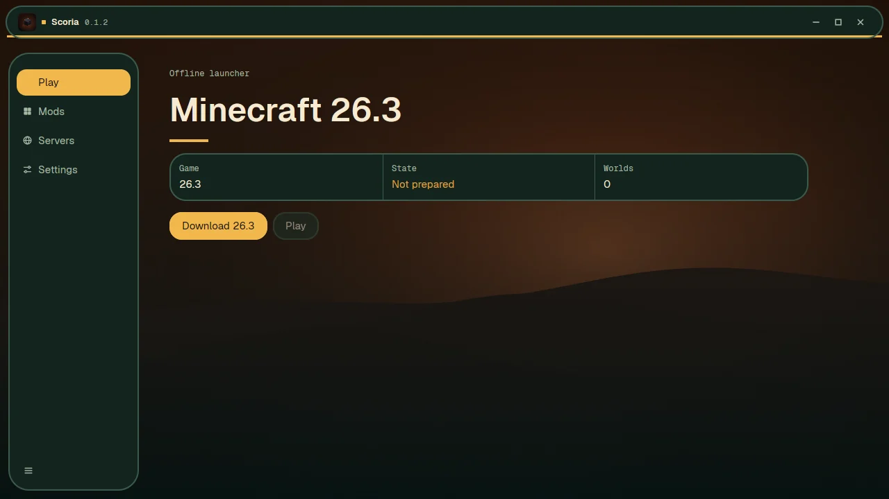
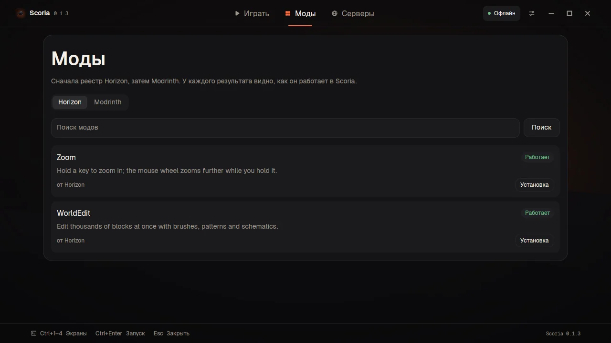
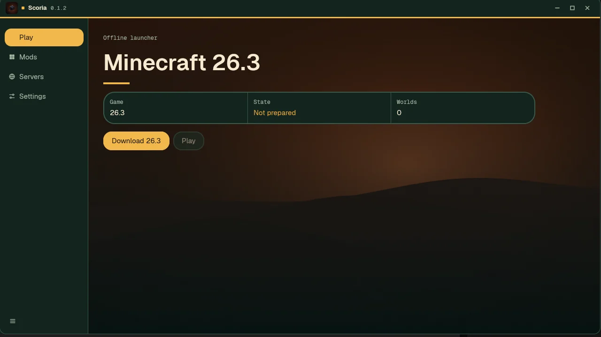

<p align="center">
  
</p>

<h1 align="center">Scoria</h1>

<p align="center">
  <b>Minecraft: Java Edition 26.3, natively in Rust.</b><br>
  Offline by default. No Microsoft account. No telemetry.
</p>

<p align="center">
  <a href="#download">Download</a> ·
  <a href="#what-works">What works</a> ·
  <a href="#screenshots">Screenshots</a> ·
  <a href="#build-from-source">Build</a> ·
  <a href="README.ru.md">Русский</a>
</p>

<p align="center">
  
  
  
</p>



## Download

| Platform | Requirements | File |
|---|---|---|
| **Linux x86_64** | Wayland session, Vulkan driver | `scoria-launcher-linux-x86_64.tar.gz` |
| **macOS 14+** | Apple silicon (M1 or newer) | `scoria-launcher-macos-arm64.zip` |
| **Windows 10/11** | x64, Vulkan driver | `scoria-launcher-windows-x64.zip` |

Every build is a **beta**: unsigned, no auto-update yet, and the game files are prepared from your
own copy of Minecraft 26.3 on first play. The SHA-256 of each file is on the release page.

## What Scoria is

A native client and launcher for Minecraft: Java Edition 26.3. It reads vanilla worlds, follows
vanilla rules and starts without a session. Your saves, options and mods stay on your machine.

- **No account.** Offline profiles, LAN and offline-mode servers. Online-mode servers need a
  Microsoft session, which Scoria does not have.
- **Your files.** Scoria uses the official launcher, Prism, Freesm, MultiMC, the Modrinth App or
  ATLauncher when 26.3 is already there; otherwise it downloads the pinned version from Mojang's
  piston-meta.
- **Modrinth, labelled.** Mods and resource packs show **Works**, **Partly** or **Doesn't run**
  before you install. Java mods are ported; Java itself is not run.
- **A real desktop app.** 1280×720, Night and Lilac themes, keyboard navigation, toasts and
  confirmations. Linux is Wayland-native; macOS and Windows use the native frame.

## What works

| | |
|---|---|
| ✅ Single player, vanilla world generation, mobs, villages, redstone, commands, HUD | ❌ Online-mode servers (no Microsoft session, by design) |
| ✅ LAN and offline-mode servers | ❌ CurseForge |
| ✅ Modrinth mods and resource packs, with support labels | ❌ Modpack browser in the launcher (the engine can import and port) |
| ✅ World backups, screenshots, options, resource packs | ❌ OptiFine/Java shader packs; Scoria's `.hshader` source is not published yet |
| ✅ Night / Lilac themes, Russian and English | ❌ Windows on ARM, Intel Macs |
| ✅ Linux (Wayland), macOS (Apple silicon), Windows (x64) | ❌ Code signing / notarization (beta) |

## Screenshots

| Home | Mods | Settings |
|---|---|---|
|  |  |  |

## Install

**Linux**

```sh
tar -xzf scoria-launcher-linux-x86_64.tar.gz
./scoria-linux-x86_64/scoria-launcher-ui
```

**macOS** — unzip, move `Scoria.app` to Applications, then open it. The beta is not notarized:
right-click → Open the first time.

**Windows** — unzip and run `Scoria.cmd`. SmartScreen will warn until the build is signed:
More info → Run anyway.

The first launch asks for nothing. Press **Download and prepare** once; Scoria fetches the pinned
26.3 files from Mojang and prepares its resources locally.

## Build from source

Rust 1.90+, Bun 1.4+, and a Vulkan-capable GPU.

```sh
cd launcher && cargo build --release
cd ../launcher-ui && bun install && bun run build
sh tools/package_ui.sh        # Linux bundle
sh tools/package_macos.sh     # macOS .app
sh tools/package_windows.sh   # Windows zip
```

Run the UI in development with `bun run dev` (Linux: native Wayland, no XWayland).

## How it is put together

```
crates/        Rust engine: client, world, protocol, assets, preparation, servers
launcher/      Rust launcher engine + JSON-lines API (horizon-launcher api)
launcher-ui/   React on GPUIX + flint-ui (screens, layout, mods, feedback)
docs/          engine and user documentation
```

The UI never touches the disk or starts the game; it talks to the launcher over JSON lines. The
launcher prepares Mojang files, ports Java mods to the Rust runtime, and starts the client.

## Status

Beta. The engine is a fork of [Horizon](https://github.com/horizon-rust/horizon); Scoria adds the
offline launcher, piston-meta downloads, Modrinth support, the new UI and its branding. The roadmap
and known gaps are in [Issues](https://github.com/wshrx/scoria/issues).

## License

MIT — see [LICENSE](LICENSE) and [THIRD_PARTY_NOTICES.md](THIRD_PARTY_NOTICES.md).

Scoria is not an official Minecraft product, is not approved by or associated with Mojang or
Microsoft, and ships no Minecraft code, assets or data. You need your own copy of Minecraft: Java
Edition 26.3.
